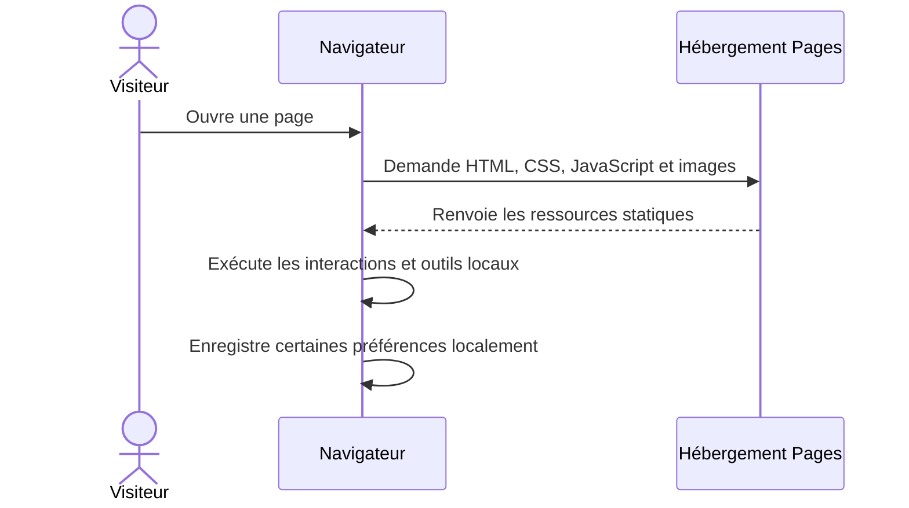
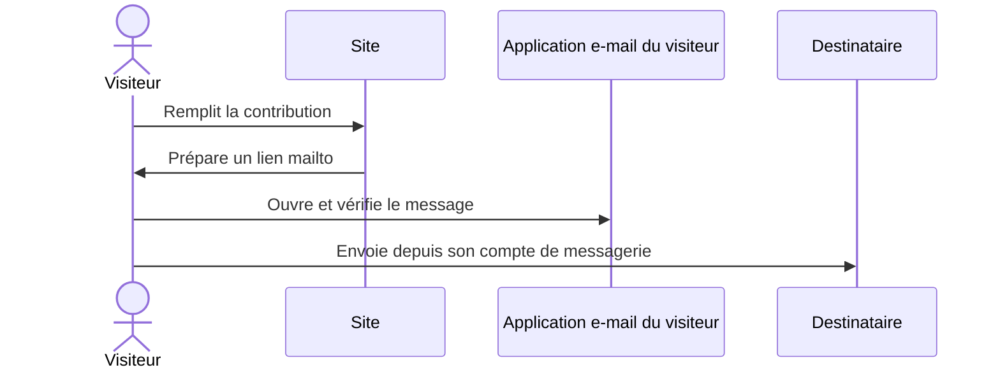
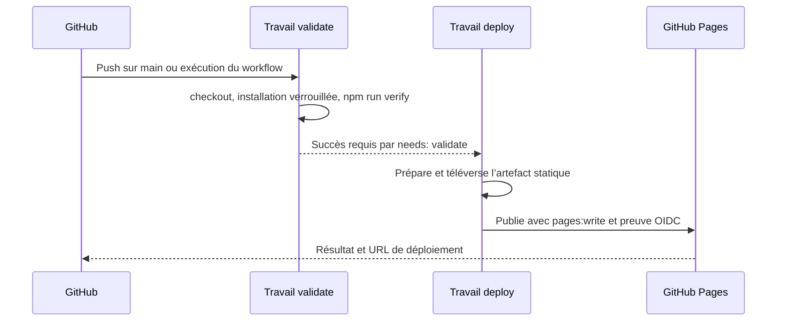

# Authentification, requêtes et jetons — référence complète

> **Périmètre.** Cette page décrit la branche `main` du dépôt public `Kevingiscard/cafe-benin-info`, consultée le 12 novembre 2026, ainsi que le flux GitHub Actions déclaré dans le dépôt. Elle ne certifie ni les réglages privés du compte GitHub, ni une configuration serveur Vercel non inspectable, ni une ancienne version hébergée.

## 1. Résumé exécutif

Le site publié sur GitHub Pages est un **site statique sans authentification de visiteurs**. Dans le code de `main`, il n’y a pas de création de compte, de connexion, de mot de passe, de cookie de session, de jeton utilisateur, de base de données métier ni d’API applicative utilisée par les fonctions principales.

Le navigateur télécharge des fichiers HTML, CSS, JavaScript et des images, puis exécute la recherche, le dictionnaire, CaféBot, les recommandations, le calculateur et plusieurs outils localement. Certaines préférences et données de travail restent dans le stockage du navigateur. **Une donnée enregistrée dans `localStorage` n’est pas une identité, une session ou une sauvegarde synchronisée.**

Le flux de justificatifs identifié concerne la **publication du site** : GitHub Actions vérifie le dépôt, puis un travail distinct publie l’artefact sur GitHub Pages avec les permissions nécessaires. Ces autorisations de CI ne font pas partie des fichiers envoyés aux visiteurs.

## 2. Périmètre et méthode de lecture

Les affirmations sur le comportement de la branche courante s’appuient sur le code et les fichiers de référence suivants :

- [`index.html`](../index.html) : page d’accueil et ressources chargées ;
- [`app.js`](../app.js) : interactions générales, recherche, thème et contribution ;
- [`local-assistant.js`](../local-assistant.js) : réponses documentaires et recommandations locales ;
- [`dictionary-v4.js`](../dictionary-v4.js) : dictionnaire et données associées ;
- [`cookie-consent.js`](../cookie-consent.js) : mémorisation du choix affiché dans la bannière ;
- [`form-guard.js`](../form-guard.js) : contrôle anti-spam exécuté dans le navigateur ;
- [`.github/workflows/validate.yml`](../.github/workflows/validate.yml) et [`.github/workflows/pages-deploy.yml`](../.github/workflows/pages-deploy.yml) : validation et publication ;
- [`api/README.md`](../api/README.md) et [`api/openapi.yaml`](../api/openapi.yaml) : contrat préparatoire, sans backend livré par Pages ;
- [`docs/SECURITY.md`](SECURITY.md) et [`docs/OPERATIONS.md`](OPERATIONS.md) : limites de sécurité et fonctionnement opérationnel.

Un fichier OpenAPI décrit une interface envisagée ; il ne prouve pas qu’un service correspondant existe ou soit déployé. De même, la présence d’un nom de variable dans une documentation historique ne prouve pas que cette variable soit configurée dans un hébergeur.

## 3. Architecture d’authentification observée

| Zone | Composants | Où le traitement a lieu | Identité ou jeton |
|---|---|---|---|
| Pages publiques | Pages HTML, styles, scripts, images | Navigateur après téléchargement des ressources statiques | Aucun compte visiteur |
| Recherche | `app.js`, contenu des sections et dictionnaire | Navigateur | Aucun appel de recherche à une API métier |
| Dictionnaire | `dictionary-v4.js` et interface associée | Navigateur | Favoris stockés localement ; pas de compte |
| CaféBot | `local-assistant.js`, `app.js` | Navigateur, avec des thèmes et réponses embarqués | Pas de fournisseur IA ni de clé API dans ce flux |
| Recommandations et outils | Scripts de la page et outils du site | Navigateur | Aucun jeton |
| Thème et consentement | `app.js`, `cookie-consent.js` | Navigateur | Choix conservés en stockage local ; ce ne sont pas des identifiants |
| Contribution | Formulaire et génération d’un lien `mailto:` | Navigateur, puis application e-mail du visiteur | Le site n’authentifie pas le compte e-mail et ne reçoit pas son mot de passe |
| Validation continue | GitHub Actions, `validate.yml` | Runner GitHub | `contents: read` déclaré au niveau du workflow |
| Publication | GitHub Actions, `pages-deploy.yml` | Runner GitHub et service Pages | `pages: write` et `id-token: write` limités au travail de déploiement |
| API projetée | `api/openapi.yaml` | Aucun serveur correspondant n’est fourni par Pages | Schéma Bearer projeté, non utilisé par le frontend courant |

### À propos de la bannière de consentement

`cookie-consent.js` conserve le choix exprimé sous la clé `cb-cookie-choice-v1`. Cela documente un choix d’interface mémorisé localement ; **cela ne crée ni compte, ni session, ni jeton d’accès**. L’existence d’une préférence intitulée « analytics » ne prouve pas, à elle seule, qu’un outil de mesure d’audience soit intégré : il faut vérifier séparément les scripts effectivement chargés.

### À propos du champ anti-spam

`form-guard.js` ajoute un champ piège et bloque une soumission trop rapide. Comme ce contrôle s’exécute dans le navigateur, il peut améliorer l’expérience et arrêter des robots simples, mais il ne peut pas imposer une règle fiable à un serveur ou empêcher directement des requêtes HTTP automatisées.

## 4. Flux d’une visite ordinaire

Le code applicatif n’a pas besoin d’un jeton pour exécuter ces fonctions. Les fichiers étant publics, l’hébergement des pages ne constitue pas un contrôle d’accès destiné à réserver leur contenu à des membres.

Le site charge la police DM Sans depuis Google Fonts. Le navigateur demande alors cette ressource au fournisseur de police. C’est une requête réseau tierce, **pas une authentification Café Bénin**. La documentation actuelle indique qu’aucun outil d’analytics tiers n’est intégré ; la présence d’une requête à Google Fonts reste un point distinct de confidentialité et de configuration.

## 5. Stockage local : portée et limites

Les scripts utilisent le stockage du navigateur pour certaines préférences et données, notamment :

- `cb-theme` pour le thème ;
- `cb-favorites` pour les favoris du dictionnaire ;
- `cb-cookie-choice-v1` pour le choix conservé par la bannière ;
- d’autres données d’outils selon les scripts et pages concernés.

Ces valeurs sont associées au navigateur et à l’origine du site. Elles peuvent disparaître si la personne efface les données du navigateur, change d’appareil ou utilise un autre profil. Le JavaScript d’une page peut également lire les valeurs enregistrées par la même origine. Il ne faut donc pas stocker de secret d’authentification dans `localStorage`.

Le stockage local n’apporte ni contrôle serveur, ni contrôle d’accès par utilisateur, ni synchronisation multi-appareil. Le modèle actuel convient à des préférences non sensibles qui restent sur l’appareil, pas à des autorisations pour des données confidentielles.

## 6. Contribution par e-mail

Le flux documenté prépare un lien `mailto:` avec le texte de contribution. Le navigateur confie ensuite la suite à l’application e-mail choisie par la personne :

Le site ne se connecte pas à la messagerie du visiteur et ne connaît pas son mot de passe. Dans ce parcours, la transmission et la conservation du message dépendent de l’application et du fournisseur de courrier.

Un lien `mailto:` ne garantit pas qu’un message ait été envoyé, reçu ou traité. Si le projet adopte plus tard un formulaire hébergé, il faudra alors documenter le destinataire, la collecte effective, la conservation, les contrôles anti-abus et les droits applicables aux données personnelles.

## 7. GitHub Actions : les jetons du déploiement

### 7.1 Validation

[`validate.yml`](../.github/workflows/validate.yml) se déclenche sur les push vers `main` et les pull requests vers `main`. Il déclare `contents: read`, installe les dépendances verrouillées avec `npm ci --ignore-scripts`, puis lance `npm run verify`.

Il s’agit d’un travail de contrôle du dépôt. Le fichier ne lui accorde pas de permissions Pages en écriture ni de permission OIDC.

### 7.2 Publication Pages

[`pages-deploy.yml`](../.github/workflows/pages-deploy.yml) se déclenche sur un push vers `main` ou manuellement. Au niveau général, il déclare `contents: read`. Son travail `validate` vérifie le site ; son travail `deploy` dépend de la réussite de cette validation.

Le travail de publication reçoit les permissions suivantes :

| Permission | Portée déclarée | Utilité dans le workflow |
|---|---|---|
| `contents: read` | Travail `deploy` | Récupérer le dépôt pour constituer l’artefact |
| `pages: write` | Travail `deploy` | Autoriser la publication sur GitHub Pages |
| `id-token: write` | Travail `deploy` | Autoriser la demande d’un jeton OIDC pour le flux Pages |

Le travail utilise l’environnement `github-pages`, prépare Pages, téléverse un artefact statique, puis appelle `actions/deploy-pages`.

GitHub documente que `id-token: write` permet au travail de demander un jeton d’identité OIDC ; ce droit, seul, n’accorde pas l’écriture dans une ressource. Le droit Pages est déclaré séparément. L’action de publication utilise ces éléments dans le cadre du déploiement. Voir la [documentation GitHub des workflows Pages personnalisés](https://docs.github.com/en/pages/getting-started-with-github-pages/using-custom-workflows) et la [référence OIDC d’Actions](https://docs.github.com/en/actions/reference/security/oidc).

GitHub crée aussi un `GITHUB_TOKEN` limité pour les travaux Actions. Les permissions déclarées déterminent ce que le workflow peut faire ; GitHub recommande de n’accorder que les permissions requises. Ce jeton est un justificatif d’automatisation attaché au travail, pas le jeton de connexion d’un visiteur. Voir [la documentation du `GITHUB_TOKEN`](https://docs.github.com/en/actions/concepts/security/github_token).

Aucun PAT personnel ni secret applicatif n’est déclaré dans le workflow observé. Cela ne permet pas d’inspecter d’éventuels secrets configurés dans les paramètres du dépôt ou d’un environnement ; la configuration privée ne se déduit pas du seul fichier YAML. Les workflows actuels n’en déclarent toutefois pas l’usage.

### 7.3 Pull requests et secrets

GitHub indique que les secrets Actions ne sont normalement pas remis aux workflows lancés par une pull request provenant d’un fork ; le `GITHUB_TOKEN` utilisé dans ce contexte est également restreint. Cette règle générale ne remplace pas l’inspection des paramètres de sécurité du dépôt, mais elle explique pourquoi une validation de contribution ne devrait pas exiger de secrets applicatifs. Voir la [documentation GitHub sur les secrets dans Actions](https://docs.github.com/en/actions/how-tos/write-workflows/choose-what-workflows-do/use-secrets).

## 8. Contrat API préparatoire et jeton Bearer envisagé

Le dossier [`api/`](../api/README.md) ne contient pas un backend fourni par GitHub Pages. `api/openapi.yaml` définit un contrat préparatoire dont le serveur est `api.example.invalid`, une adresse de remplacement. Il ne décrit donc pas une API de production actuellement joignable depuis le site.

Ce contrat prévoit notamment :

- `GET /health`, pour un contrôle de disponibilité ;
- `GET /v1/observations`, pour lire des données agrégées ;
- `POST /v1/professional-submissions`, pour soumettre une contribution modérée ;
- un schéma HTTP Bearer pour cette dernière opération.

Un schéma Bearer signifie qu’un futur client enverrait un jeton dans l’en-tête HTTP `Authorization: Bearer …`. Le contrat précise que le jeton serait réservé au serveur et ne devrait pas être intégré au frontend. Tant qu’un service et une politique d’émission des jetons ne sont pas effectivement déployés, **il n’existe aucun flux de connexion correspondant dans le site**.

Le contrat ouvert ne précise pas à lui seul comment les jetons seraient créés, qui pourrait en obtenir un, leur audience, leur durée de vie, leur révocation, ni comment protéger les contributions contre les abus. Ces décisions doivent être prises avant la mise en production.

## 9. Vercel et prototypes des versions précédentes

Les documents du dépôt mentionnent des prototypes V2/V3 et une ancienne version Vercel avec des routes serveur pour l’IA ou les commentaires. Ils signalent des variables telles que `GEMINI_API_KEY`, `SUPABASE_URL`, `SUPABASE_KEY`, `GMAIL_USER` et `GMAIL_PASSWORD`. Ces noms concernent des versions historiques décrites par le dépôt ; ils ne sont pas des variables requises par la branche `main`.

La documentation indique aussi que le code serveur réellement déployé sur Vercel n’a pas été inspecté lors de l’audit précédent. Il ne faut donc pas déduire de cette page que l’ancienne adresse Vercel est protégée, encore active ou correctement configurée. Le dépôt contient une règle de redirection dans `vercel.json`, mais son effet dépend du déploiement effectif de cette configuration chez Vercel.

Règles de traitement des clés mentionnées dans ces prototypes :

- une clé API privée, un mot de passe Gmail ou une clé Supabase privilégiée doit rester dans un coffre de secrets côté serveur ;
- une variable écrite dans un bundle JavaScript ou injectée dans le navigateur devient visible par les visiteurs ;
- une clé Supabase `anon` est un identifiant de projet public soumis aux règles de sécurité de la base ; elle n’identifie pas une personne et ne remplace pas une politique RLS correcte ;
- CORS contrôle quels navigateurs peuvent lire certaines réponses cross-origin ; il n’authentifie pas le demandeur et ne bloque pas les clients qui appellent directement l’API ;
- une URL Ollama en `localhost` dans une fonction cloud désigne l’environnement de cette fonction, pas l’ordinateur du visiteur.

## 10. Glossaire des termes

| Terme | Définition dans le contexte du site |
|---|---|
| Authentification | Vérification de l’identité d’un utilisateur ou d’un service. Aucune authentification de visiteur n’est implémentée dans `main`. |
| Autorisation | Règles qui déterminent quelles actions une identité déjà reconnue peut réaliser. Une permission GitHub Actions est une autorisation du travail automatisé, pas d’un visiteur. |
| Session | État qui relie plusieurs requêtes à une connexion. Aucune session applicative n’est mise en place pour les visiteurs. |
| Cookie | Petite donnée envoyée ou stockée par le navigateur selon des règles d’origine et de domaine. Aucun cookie de session Café Bénin n’est décrit dans le frontend courant. |
| `localStorage` | Stockage clé-valeur persistant dans le navigateur pour une origine. Ce n’est ni un stockage serveur ni un mécanisme d’identité. |
| Jeton d’accès | Valeur présentée à un service pour l’autoriser selon une portée et une durée définies. Le frontend courant n’en utilise pas pour des visiteurs. |
| PAT | Jeton d’accès personnel GitHub, créé pour un compte ou une intégration. Aucun PAT n’est déclaré dans le workflow Pages inspecté. |
| `GITHUB_TOKEN` | Jeton d’installation GitHub App créé automatiquement pour un travail Actions et limité par les permissions du workflow. |
| OIDC | Protocole d’identité qui permet à un workflow de présenter une preuve temporaire de son contexte à un service compatible, sans stocker nécessairement un secret long terme. |
| `id-token: write` | Permission Actions qui permet de demander un jeton OIDC ; elle ne donne pas, à elle seule, un droit d’écriture Pages. |
| Bearer | Schéma HTTP où le détenteur du jeton le présente dans l’en-tête Authorization. Le contrat API le prévoit pour un futur endpoint ; le site courant ne l’utilise pas. |
| Secret | Valeur confidentielle, par exemple une clé API privée ou un mot de passe, conservée côté serveur ou dans le coffre de secrets du fournisseur. |
| CORS | Mécanisme navigateur de contrôle d’accès aux réponses entre origines. Ce n’est ni une authentification ni une protection contre les appels directs. |
| RLS | Contrôle d’accès au niveau des lignes de base de données, par exemple dans PostgreSQL/Supabase. Une clé publique de projet ne remplace pas ces règles. |
| Frontend | Code exécuté par le navigateur et inspectable par les visiteurs. Il ne peut pas protéger durablement une clé secrète embarquée. |
| Backend | Service serveur contrôlé par le projet, où peuvent être validés l’identité, les permissions, les données et les secrets. Aucun backend métier n’est livré par le site statique actuel. |

## 11. Limites de l’audit

Cette analyse décrit le contenu accessible de la branche `main` et les workflows qui y sont déclarés. Elle ne donne pas accès aux secrets privés du dépôt, aux réglages complets des environnements GitHub, à l’historique complet des déploiements, ni à la configuration effective du projet Vercel. Les anciennes versions nécessitent un audit séparé si elles doivent être remises en service.

Une affirmation sur le code du dépôt ne constitue pas une garantie sur la configuration de l’hébergeur, le DNS, les caches, les paramètres du compte, ou le comportement d’une version déjà déployée.

## 12. Plan de référence avant d’ajouter des comptes ou un backend

Avant de synchroniser des favoris ou d’accepter des contributions dans une base, établir et documenter les éléments suivants :

1. **Besoin produit** : quelles fonctions exigent réellement un compte, et lesquelles peuvent rester locales ou publiques.
2. **Fournisseur d’identité** : inscription, connexion, MFA si pertinent, récupération, fermeture de compte et révocation de session.
3. **Frontières de confiance** : le navigateur est contrôlé par le visiteur ; toute permission sensible doit être revérifiée côté serveur.
4. **Modèle de rôles** : visiteur, contributeur, modérateur et administrateur, avec accès minimal à chaque ressource.
5. **API** : validation stricte de méthode, schéma, taille, type de contenu, origine selon le besoin, fréquence et idempotence.
6. **Jetons** : audience, portée, expiration courte, renouvellement, révocation, stockage et rotation ; ne jamais confondre une clé publique de projet et un jeton d’identité.
7. **Base** : politiques RLS activées et testées, accès par propriétaire des données, compte de service réservé au serveur.
8. **Anti-abus** : limitation de débit côté serveur, quotas, détection de répétition, protection des coûts IA et procédure de blocage.
9. **Données personnelles** : finalité, base légale, minimisation, information, conservation, export, correction et suppression.
10. **Secrets** : coffre du fournisseur côté serveur, environnements séparés, droits minimum, rotation et procédure de révocation après fuite.
11. **Observabilité** : journaux minimisés, identifiants de corrélation, alertes utiles, absence de mots de passe, jetons ou contenus sensibles dans les logs.
12. **Publication** : permissions Actions minimales, environnement protégé, revue des dépendances et des actions tierces, validation obligatoire avant publication.
13. **Tests de sécurité** : refus d’accès sans identité, isolation entre utilisateurs, privilèges d’administration, abus de quota, injection, XSS et révocation.

Pour la situation actuelle, aucune de ces fonctions de compte n’est requise par le site statique ; ce plan est une condition de conception pour un futur backend, pas la description d’une fonctionnalité déjà active.

## 13. Références

### Dans le dépôt

- [README](../README.md)
- [Sécurité et confidentialité](SECURITY.md)
- [Exploitation et publication](OPERATIONS.md)
- [API hors frontend](../api/README.md)
- [Contrat OpenAPI préparatoire](../api/openapi.yaml)
- [Workflow de validation](../.github/workflows/validate.yml)
- [Workflow GitHub Pages](../.github/workflows/pages-deploy.yml)

### Documentation GitHub

- [Workflows personnalisés de GitHub Pages](https://docs.github.com/en/pages/getting-started-with-github-pages/using-custom-workflows)
- [Référence OIDC pour GitHub Actions](https://docs.github.com/en/actions/reference/security/oidc)
- [Concept du jeton `GITHUB_TOKEN`](https://docs.github.com/en/actions/concepts/security/github_token)
- [Utilisation des secrets dans les workflows](https://docs.github.com/en/actions/how-tos/write-workflows/choose-what-workflows-do/use-secrets)
- [Référence des événements déclenchant les workflows](https://docs.github.com/en/actions/reference/workflows-and-actions/events-that-trigger-workflows)
